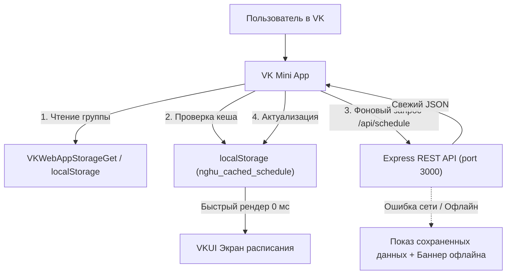

# 🎨 Спецификация: VK Mini App «Расписание занятий НГХУ»

## 1. Введение и цели

**Цель проекта**: Создание нативного мини-приложения ВКонтакте (**VK Mini App**) для студентов и преподавателей Новосибирского государственного художественного училища (НГХУ).
Приложение предоставляет мгновенный доступ к расписанию занятий, занятости аудиторий в обоих корпусах училища и каталогу преподавателей непосредственно внутри экосистемы ВКонтакте (в мобильных клиентах VK на iOS/Android и десктопной версии сайта vk.com) без необходимости скачивания и установки APK.

### Ключевые преимущества:
- **Бесшовный доступ**: Запуск в один клик из группы училища, чатов или каталога сервисов ВКонтакте.
- **Интеграция с профилем VK**: Автоматическое облачное сохранение выбранной студентом группы через `VKWebAppStorageSet`.
- **Offline-First & Сверхбыстрый старт**: Локальное кеширование расписания в браузере, нулевая задержка при открытии.
- **Единый бэкенд**: Повторное использование существующего надежного REST API сервера (`server/`).

---

## 2. Архитектура и структура проекта

Мини-приложение размещается в каталоге `vk-mini-app/` в рамках монорепозитория:

```text
nghuapp/
├── server/                   # Существующий Node.js / Express 5 REST API
├── android/                  # Нативное Android-приложение (Kotlin + Compose)
└── vk-mini-app/              # [NEW] VK Mini App (React + VKUI + Vite)
    ├── public/
    │   └── favicon.svg
    ├── src/
    │   ├── api/              # Клиент к REST API бэкенда
    │   │   └── client.ts     # Запросы к /schedule, /groups, /rooms, /teachers
    │   ├── components/       # Переиспользуемые компоненты UI:
    │   │   ├── DaySelector/  # Горизонтальная лента дней недели (ПН-СБ) с чипом «Сегодня»
    │   │   ├── LiveWidget/   # Индикатор текущей пары / перемены / смены корпусов
    │   │   ├── LessonCard/   # Карточка занятия с временной шкалой и бейджами корпусов
    │   │   ├── BreakCard/    # Карточка перемены между парами
    │   │   └── GroupModal/   # Модальная шторка выбора группы с фильтром курсов (1..4)
    │   ├── hooks/            # Пользовательские React-хуки:
    │   │   ├── useSchedule.ts# Загрузка и кеширование расписания
    │   │   ├── useLiveStatus.ts # Реактивный таймер текущей пары и перехода
    │   │   └── useVkStorage.ts  # Чтение/запись группы в VK Cloud Storage & localStorage
    │   ├── panels/           # Основные экраны (VKUI Panels):
    │   │   ├── SchedulePanel.tsx  # Экран расписания группы
    │   │   ├── RoomsPanel.tsx     # Экран аудиторий и занятости
    │   │   └── TeachersPanel.tsx  # Экран каталога преподавателей
    │   ├── types/            # TypeScript типы (согласованы с бэкендом)
    │   │   └── index.ts
    │   ├── utils/            # Вспомогательные функции (форматирование времени, расчет корпусов)
    │   │   └── timeUtils.ts
    │   ├── App.tsx           # Корневой макет с VKUI AppRoot, SplitLayout, View и Tabbar
    │   ├── index.css         # Глобальные стили
    │   └── main.tsx          # Инициализация vkBridge и рендеринг React
    ├── index.html
    ├── vite.config.ts        # Конфигурация Vite с реверс-прокси к http://localhost:3000
    ├── tsconfig.json
    └── package.json
```

---

## 3. Взаимодействие с платформой ВКонтакте (VK Bridge)

1. **Инициализация**:
   При монтировании `main.tsx` вызывается:
   ```typescript
   import vkBridge from '@vkontakte/vk-bridge';
   vkBridge.send('VKWebAppInit');
   ```
2. **Адаптивная тема**:
   Слушатель события `VKWebAppUpdateConfig` динамически передает текущую цветовую схему (`client_template`, `appearance: 'light' | 'dark'`) в `ConfigProvider` библиотеки VKUI.
3. **Облачное хранилище профиля**:
   - Чтение сохраненной группы: `vkBridge.send('VKWebAppStorageGet', { keys: ['nghu_selected_group'] })`.
   - Сохранение выбранной группы: `vkBridge.send('VKWebAppStorageSet', { key: 'nghu_selected_group', value: groupName })`.
   - Резервный механизм: при запуске вне VK или ошибке API данные читаются и пишутся в `localStorage`.
4. **Тактильная отдача (Haptic Feedback)**:
   При кликах по дням недели и переключении вкладок Tabbar вызывается:
   ```typescript
   vkBridge.send('VKWebAppTapticImpactOccurred', { style: 'light' });
   ```

---

## 4. Пользовательский интерфейс и экраны (VKUI)

### 4.1. Корневая навигация
Используется нижнее нативное меню `Tabbar` с тремя вкладками:
1. 📅 **Расписание** (`SchedulePanel`)
2. 🏢 **Аудитории** (`RoomsPanel`)
3. 👨‍🏫 **Преподаватели** (`TeachersPanel`)

### 4.2. Экран «Расписание» (`SchedulePanel`)
- **PanelHeader**:
  Заголовок содержит кнопку с текущей выбранной группой (например, `Группа Д-11 ▾`).
  Клик открывает модальное окно `GroupModal` (`ModalPage` VKUI):
  - Поисковая строка по названию группы.
  - Фильтр-чипы по курсам (1, 2, 3, 4 курс).
  - Сгруппированные списки по отделениям: Дизайн (Д), Живопись (Ж), Театрально-декорационное (Т).
- **Лента дней недели (`DaySelector`)**:
  Горизонтальный список дней (ПН, ВТ, СР, ЧТ, ПТ, СБ). Выбранный день подсвечивается. Текущий день календаря отмечен специальным маркером «Сегодня».
- **Живой виджет текущей пары (`LiveWidget`)**:
  - Во время занятия: отображает номер пары, название предмета, кабинет, оставшееся время в минутах и прогресс-бар.
  - Во время перемены: отображает время до следующего звонка.
  - **Предупреждение о переходе**: Если следующая пара проходит в другом здании училища, выводится заметный баннер с предупреждением:
    *«⚠️ Переход между корпусами! Красный пр-т, 9 → ул. Спартака, 12»*.
- **Список занятий**:
  - Карточки предметов (`LessonCard`) с временем начала/конца, преподавателем, категорией.
  - Бейджи корпусов:
    - 🏢 **Сине-серый бейдж**: Главный корпус (Красный пр-т, 9).
    - 🏛️ **Терракотово-оранжевый бейдж**: Корпус на ул. Спартака, 12.
  - Разделительные карточки перемен (`BreakCard`) с указанием длительности.
- **Жест Pull-to-Refresh**: свайп вниз для перезагрузки расписания.

### 4.3. Экран «Аудитории» (`RoomsPanel`)
- Поисковая строка по номеру кабинета, предмету или фамилии педагога.
- Фильтры по корпусам: `Все`, `Красный пр-т, 9`, `ул. Спартака, 12`.
- Счётчики в реальном времени: количество свободных (зеленый) и занятых (красный) аудиторий.
- Раскрывающаяся карточка кабинета с почасовой сеткой занятости на текущий день.

### 4.4. Экран «Преподаватели» (`TeachersPanel`)
- Поиск по имени педагога или преподаваемой дисциплине.
- Алфавитная группировка с контрастным аватаром инициалов.
- Раскрывающийся список пар преподавателя по всем группам училища.

---

## 5. Потоки данных и офлайн-режим



- **Отказоустойчивость**: При сетевых ошибках пользователю выдается сохраненная версия с ненавязчивым уведомлением *«Офлайн-режим • Показаны сохраненные данные»* и кнопкой *«Повторить попытку»*.
- **Расписание звонков училища**:
  - 1 пара: 09:00 - 10:35 (перемена 10 мин)
  - 2 пара: 10:45 - 12:20 (большая перемена 40 мин)
  - 3 пара: 13:00 - 14:35 (перемена 10 мин)
  - 4 пара: 14:45 - 16:20 (перемена 10 мин)
  - 5 пара: 16:30 - 18:05

---

## 6. Тестирование и верификация

1. **Модульные тесты (Vitest)**:
   - Расчёт интервалов пар, определение текущего занятия и перемены.
   - Определение смены корпусов между последовательными занятиями.
   - Корректность работы слоя сохранения (VK Storage / localStorage fallback).
2. **Сборка проекта**:
   - `npm run build` выполняет проверку типов TypeScript (`tsc`) и сборку минимизированного бандла через Vite.
3. **Локальное тестирование**:
   - Локальный сервер на порту `5173` с проксированием `/api` к бэкенду.
   - Поддержка туннелирования через `@vkontakte/vk-tunnel` для валидации работы в мобильном клиенте VK.
